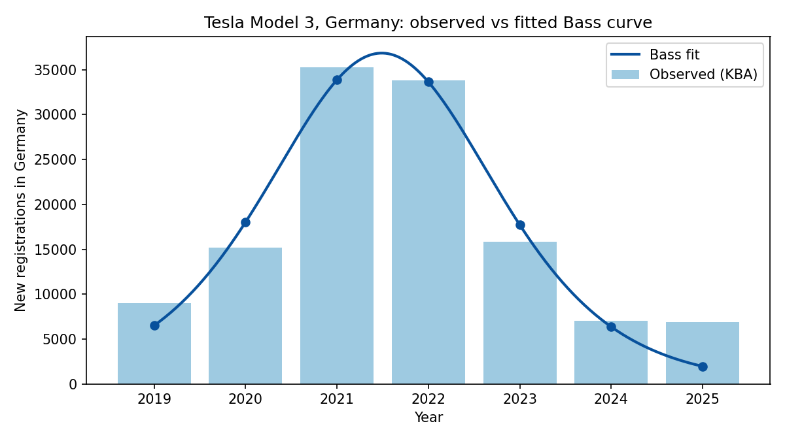
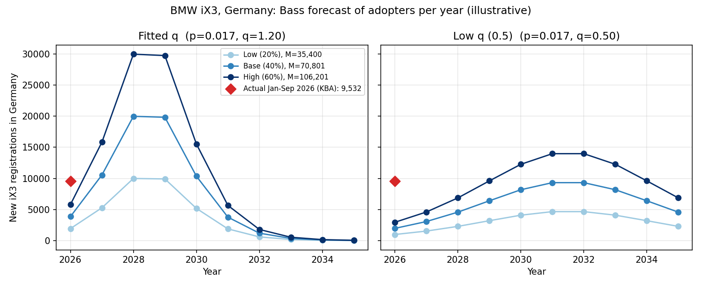

# Summary

This report forecasts the diffusion of the **BMW iX3 (Neue Klasse)**, one of TIME's Best Inventions of 2025, in **Germany**. The Bass model's innovation and imitation coefficients (p and q) are estimated from a look-alike product, the **Tesla Model 3 in Germany** (KBA registrations, 2019-2025). Market potential M for the iX3 is estimated separately with Fermi logic.

- Look-alike estimates: p about 0.017, q about 1.20, m about 120,000.
- Market potential for the iX3 in Germany: about 35,400 / 70,800 / 106,200 (low / base / high).
- Headline forecast (fitted q, base M): about **20,000 iX3 registrations a year at the peak, around 2028-2029**.
- Validation: actual registrations in January-September 2026 (9,532) are **already above** the model's forecast for all of 2026 (3,861). This is discussed as a limitation in Section 7.

# 1. Chosen innovation (Step 1)

**BMW iX3 (Neue Klasse):** <https://time.com/collections/best-inventions-2025/7318539/bmw-ix3/>

- TIME's write-up says BMW invested more than $11 billion in the Neue Klasse platform, and that the iX3 is claimed to reach about 400 miles of range and to add about 175 miles of charge in 10 minutes (TIME).
- BMW reported more than 3,000 orders in the six weeks after the September 2025 debut ([GoAuto](https://www.goauto.com.au/amp/97731/neue-klasse-ix3-orders-surpass-expectation.html)). Electrek reported more than 50,000 orders within six months; the geographic scope of that figure is not stated ([Electrek](https://electrek.co/2026/03/17/bmw-ix3-orders-surge-past-50000-deliveries-now-underway/)).
- The Debrecen plant has a capacity of roughly 150,000 vehicles a year once fully ramped up, serving several markets ([BMWBlog](https://www.bmwblog.com/?p=506637)).
- Launch coverage gave a German price of EUR 68,900 and European sales from March 2026 ([wire report](https://bbc.bm/?p=23202)); a German EV database lists the entry price as EUR 70,900 ([elektroquatsch.de](https://www.elektroquatsch.de/elektroautos/modell/bmw-ix3)). Sources differ, so prices in this report are indicative.
- The Neue Klasse iX3 is a different car from the first-generation iX3, which shared the X3's underpinnings ([Citizen](https://www.citizen.co.za/network-news/?p=1459509)). Only the new model is analysed here.

# 2. Look-alike innovation (Step 2)

I selected the **Tesla Model 3** as the look-alike for the iX3. Both are mid-size, premium, battery-electric cars, aimed at buyers who would otherwise consider a premium combustion car such as the BMW 3 Series or X3. In Germany the Model 3 was the second-best-selling premium mid-size car in 2021, behind only the BMW 3 Series, and the best-selling electric car overall ([European Alternative Fuels Observatory](https://alternative-fuels-observatory.ec.europa.eu/node/80)). This is the segment and the kind of buyer the iX3 targets.

The two products differ in ways that limit the comparison. The Model 3 is a sedan and the iX3 an SUV. Tesla entered as a new brand with its own sales and charging model, while BMW sells through an established dealer network. The Model 3 launched when German buyers could claim a purchase subsidy (up to EUR 9,000 in 2020, [best-selling-cars.com](https://www.best-selling-cars.com/germany/2020-full-year-germany-best-selling-electric-cars-by-brand-and-model/)), whereas the iX3 launched after that subsidy ended unexpectedly in December 2023 ([best-selling-cars.com](https://www.best-selling-cars.com/germany/2024-full-year-germany-best-selling-electric-cars-by-brand-and-model/)). I therefore treat the look-alike's p and q as an approximation of how an innovative premium EV spreads in Germany, and I estimate market potential M for the iX3 separately.

**Technology comparison.** Both cars compete on the attributes that matter most to premium electric buyers: range, fast charging and software.

| Attribute | Tesla Model 3 | BMW iX3 (Neue Klasse) |
|---|---|---|
| Body type | Sedan | SUV (BMW calls it an SAV) |
| WLTP range | Long Range RWD: 702 km (European spec, 2024 onward) | 50 xDrive: up to about 800 km |
| Max DC charging | 250 kW | 400 kW (800 V architecture) |
| Software | Over-the-air updates add range and features over time | "Software-defined vehicle": four central computers, over-the-air updates |
| Price (Germany) | about EUR 45,000 (Long Range RWD) | about EUR 69,000-71,000 |

Sources: Model 3 range, charging and price ([EV Specs](https://www.evspecs.org/tech-specs/tesla/model-3/long-range-rwd)); Model 3 over-the-air updates, with one Dutch review reporting a Long Range model's WLTP range rising from 560 km to 614 km over about three years ([Advocatie.nl](https://www.advocatie.nl/?p=71632)); iX3 800 V platform, software-defined design and voltage "double that of Tesla's" ([IEEE Spectrum](https://spectrum.ieee.org/bmw-ix3-neue-klasse)); iX3 400 kW charging and four central computers ([Wards Auto](https://www.wardsauto.com/news/bmw-unveils-clean-sheet-electric-ix3/798927/)); iX3 range of up to 800 km ([Electrive](https://www.electrive.com/2025/06/11/bmw-reveals-more-details-about-the-ix3)).

The iX3 therefore offers the same kind of proposition as the Model 3 (long range, fast charging, software that improves over time), with a more advanced charging system. Note that the Model 3 itself changed during the data window: at its 2019 European launch the Long Range had a 560 km WLTP range ([auto motor und sport](https://www.auto-motor-und-sport.de/elektroauto/tesla-model-3-preise-reichweite/)), so the sales series covers several versions of the car.

# 3. Historical data (Step 3)

**Series:** Tesla Model 3, new passenger-car registrations in Germany per year. **Primary source:** Kraftfahrt-Bundesamt (KBA, <https://www.kba.de/>). Registrations are used as a proxy for sales. The figures below are KBA data as republished by the sources listed; where two independent sources agree, the figure is marked as cross-checked.

| Year | t | Registrations | Cumulative | Cross-checked | Sources |
|---|---|---|---|---|---|
| 2019 | 1 | 9,013 | 9,013 | no | [best-selling-cars.com](https://www.best-selling-cars.com/germany/2019-full-year-germany-best-selling-electric-cars-by-brand-and-model/) |
| 2020 | 2 | 15,202 | 24,215 | no | [best-selling-cars.com](https://www.best-selling-cars.com/germany/2020-full-year-germany-best-selling-electric-cars-by-brand-and-model/) |
| 2021 | 3 | 35,262 | 59,477 | yes | [autohub.de](https://autohub.de/en/?p=8943), [DriveTeslaCanada](https://driveteslacanada.ca/?p=40338) |
| 2022 | 4 | 33,841 | 93,318 | yes | [best-selling-cars.com](https://www.best-selling-cars.com/electric/2022-full-year-germany-best-selling-electric-cars-by-brand-and-model/), [InsideEVs Germany](https://insideevs.de/news/703557/elektroautomarkt-2023-deutschland-meistverkaufte-modelle/) |
| 2023 | 5 | 15,865 | 109,183 | yes | [InsideEVs Germany](https://insideevs.de/news/703557/elektroautomarkt-2023-deutschland-meistverkaufte-modelle/), [Leinetal24](https://www.leinetal24.de/leben/auto/elektroautos-stromer-deutschland-beliebteste-neuzulassungen-kraftfahrtbundesamt-kba-2023-zr-92778895.html) |
| 2024 | 6 | 7,012 | 116,195 | yes | [best-selling-cars.com](https://www.best-selling-cars.com/germany/2024-full-year-germany-best-selling-electric-cars-by-brand-and-model/), [teslabs.de](https://teslabs.de/en/blogs/tesla-must-knows-en/tesla-registrations-current-registration-numbers) |
| 2025 | 7 | 6,855 | 123,050 | no | [best-selling-cars.com](https://www.best-selling-cars.com/germany/2025-full-year-germany-best-selling-electric-cars-by-brand-and-model/) |

2026 is a partial year (10,557 registrations from January to August, [eletric-vehicles.com](https://eletric-vehicles.com/tesla/teslas-german-registrations-hit-highest-since-2022-passing-byd-for-year/)) and is excluded from the fit. A robustness series for the Model Y in Germany is included in the repository (`data/modely_germany_annual.csv`).

# 4. Estimation of the Bass parameters (Step 4)

## 4.1 Methods

The Bass model gives the number of adopters in period t as m times the density f(t), with F(t) = (1 - e^(-(p+q)t)) / (1 + (q/p) e^(-(p+q)t)) and f(t) = dF/dt. Three estimators were used, with t = 1 for 2019:

1. **Nonlinear least squares in the lecture's form** (sales = m * f(t), start values m = total sales, p = 0.02, q = 0.4), with additional random starting points to avoid local minima.
2. **A discrete-period version** (sales = M * [F(t) - F(t-1)]) fitted the same way (Srinivasan and Mason, 1986).
3. **Bass's original regression** (Bass, 1969) of sales on lagged cumulative sales and its square.

## 4.2 Results

| Method | p | q | m / M |
|---|---|---|---|
| Lecture-style nls | 0.0173 (SE 0.0058) | 1.197 (SE 0.122) | 120,286 (SE 8,760) |
| Discrete nls | 0.0290 | 1.222 | 118,876 |
| Bass OLS (lagged cumulative sales) | 0.093 | 0.975 | 118,043 |

The lecture-style fit has R^2 of about 0.95 and a residual standard error of 3,234 on 4 degrees of freedom. The predicted peak is t* = ln(q/p)/(p+q) = 3.49, against an actual peak in t = 3 (2021). Residual-bootstrap 95% intervals for the discrete fit are 0.021-0.045 for p, 1.02-1.37 for q and 111,000-136,000 for M. Fitting only 2019-2023 gives p = 0.025, q = 1.31 and M = 115,000, so p and q are fairly stable, although p is the least well-identified parameter (the OLS estimate is 0.09).

{ width=75% }

## 4.3 Caveats

- **M is slightly below observed cumulative sales (123,050).** The model misses the tail: it predicts about 2,000 registrations for 2025 against 6,855 actual. In a hold-out test (fit on 2019-2023), the model predicts 5,255 and 1,465 for 2024-2025 against 7,012 and 6,855 actual. Because M is replaced by a separate estimate for the iX3, this matters little for the forecast.
- **q is high.** Bass's original estimates, shown in the course material, range from about 0.17 to 0.65; the fitted q of 1.2 is almost twice the highest. The steep rise and fall probably reflect subsidies, supply arriving in batches, and later cannibalization by the Model Y, not only word of mouth.
- **Only seven annual observations** are available for three parameters, so the estimates carry wide uncertainty.

# 5. Scope (Step 6)

The analysis is **country-specific: Germany.**

- The look-alike data come from Germany (KBA), so p and q are estimated in the same market, and the market-potential estimate in Section 6 is also based on German data.
- Germany is BMW's home market, and the iX3 launched first in Europe.
- KBA publishes registrations by model every month, so each step can be checked and compared with actual results.
- For context, the IEA reports that global electric car sales exceeded 20 million in 2025, about a quarter of all new cars ([IEA](https://www.iea.org/reports/global-ev-outlook-2026/trends-in-electric-cars)), and fell by about 8% in the first quarter of 2026 after policy changes in China and the US ([IEA](https://www.iea.org/news/close-to-30-of-cars-sold-this-year-are-set-to-be-electric-as-countries-and-consumers-respond-to-energy-crisis)).

# 6. Market potential M for the iX3: Fermi estimate (Step 7)

Because the iX3 is too new for a fitted M, I estimate it with Fermi logic:

> M = X3-family registrations per year in Germany x iX3 share of the family x lifecycle in years

| Input | Type | Value | Basis |
|---|---|---|---|
| BMW X3-family registrations in Germany, 2025 | Data | 25,286 | KBA, as shown on [angurten.de](https://www.angurten.de/is/abmessungen/2158-X3+%28G45%29) |
| Model lifecycle | Data (rounded) | 7 years | previous X3 generation from 2017, current from 2024 (same source); also equals the 7-year window of the look-alike series |
| iX3 share of the X3 family | **Assumption** | 20% / 40% / 60% | Analog: the electric BMW X1 had 18,957 of 47,143 registrations in Germany in 2025, about 40% ([best-selling-cars.com](https://www.best-selling-cars.com/germany/2025-full-year-germany-best-selling-electric-cars-by-brand-and-model/)). The low case is about Germany's overall BEV share of 19.1% (same source). The high case reflects the iX3 being the flagship of the new platform. |
| **M = 25,286 x share x 7** | Estimate | **35,400 / 70,800 / 106,200** | calculation |

Sanity checks: the Model 3 reached 123,050 cumulative registrations over seven years, with a peak of 35,262 in 2021, so the estimate brackets that scale from below. The Debrecen capacity of about 150,000 vehicles a year, which serves several markets, is far above the German peak in every scenario.

The share of the X3 family is the only assumption; all other inputs are cited data. The model treats the X3 family as one pool of buyers, so the iX3 may enlarge it or take sales from the combustion X3.

# 7. Forecast of iX3 adopters (Steps 5 and 7)

## 7.1 Set-up

The forecast uses the look-alike's p and q, the Fermi estimate of M, t = 1 in 2026 (the launch year), and the lecture's form adopters(t) = M * f(t).

| Parameter | Value | Basis |
|---|---|---|
| p | 0.0173 | lecture-style nls on the Model 3 series (Section 4) |
| q, headline | 1.197 | same fit |
| q, sensitivity | 0.5 | assumption: within the range of Bass's original estimates (about 0.17-0.65) |
| M | 35,400 / 70,800 / 106,200 | Section 6 |

**Headline scenario: fitted q (1.20) with the base share (40%), M = 70,801.** The assignment asks for p and q to be estimated from a look-alike's time series, so the headline forecast uses the values the data produced instead of a value chosen by hand. This keeps the forecast reproducible. For market potential I use the middle of the 20-60% range, anchored on the electric X1 analog.

The headline result should be treated with caution. The fitted q is almost twice the highest of Bass's original estimates and probably reflects more than word of mouth: subsidies, batch supply and cannibalization by the Model Y. The headline case is therefore a fast-adoption scenario. It implies a peak of about 20,000 registrations a year, roughly 80% of the whole X3 family's 2025 volume in Germany. To show how much the result depends on q, I also report q = 0.5, which gives a peak of about 9,500 a year around 2031-2032 and only about 60% of M adopted after seven years. The share assumption mainly changes the **size** of the forecast, while q mainly changes its **timing and steepness**.

## 7.2 Scenarios

| iX3 share | M | q case | Peak year (approx.) | Peak adopters per year | 2026 adopters | % of M realized by year 7 | by year 10 |
|---|---|---|---|---|---|---|---|
| 20% | 35,400 | fitted (1.20) | 2028-29 | 10,899 | 1,930 | 98% | 99% |
| 20% | 35,400 | low (0.5) | 2031-32 | 4,737 | 983 | 60% | 88% |
| **40%** | **70,801** | **fitted (1.20)** | **2028-29** | **21,798** | **3,861** | **98%** | **99%** |
| 40% | 70,801 | low (0.5) | 2031-32 | 9,473 | 1,966 | 60% | 88% |
| 60% | 106,201 | fitted (1.20) | 2028-29 | 32,696 | 5,791 | 98% | 99% |
| 60% | 106,201 | low (0.5) | 2031-32 | 14,210 | 2,948 | 60% | 88% |

The peak year uses t* = ln(q/p)/(p+q). "Peak adopters per year" is the maximum of the continuous curve, M(p+q)^2/(4q); the yearly values below, evaluated at whole years, are slightly lower. Even the high-share case peaks at about 33,000 a year, about 22% of the Debrecen plant's capacity.

## 7.3 Adopters per year: base case (40% share, M = 70,801)

| Year | t | Fitted q: adopters | cumulative | Low q (0.5): adopters | cumulative |
|---|---|---|---|---|---|
| 2026 | 1 | 3,861 | 3,861 | 1,966 | 1,966 |
| 2027 | 2 | 10,552 | 14,412 | 3,065 | 5,031 |
| 2028 | 3 | 19,981 | 34,394 | 4,575 | 9,606 |
| 2029 | 4 | 19,832 | 54,226 | 6,399 | 16,005 |
| 2030 | 5 | 10,360 | 64,585 | 8,177 | 24,181 |
| 2031 | 6 | 3,773 | 68,358 | 9,316 | 33,497 |
| 2032 | 7 | 1,196 | 69,553 | 9,318 | 42,815 |
| 2033 | 8 | 362 | 69,916 | 8,182 | 50,996 |
| 2034 | 9 | 108 | 70,024 | 6,405 | 57,402 |
| 2035 | 10 | 32 | 70,056 | 4,581 | 61,982 |

Because f(t) is evaluated at whole years, the cumulative sum reaches about 99% of M under the fitted q.

# 8. Validation against early data

Actual registrations of the new iX3 in Germany in 2026 (KBA data as published by [GoingElectric](https://www.goingelectric.de/zulassungszahlen/bmw-ix3/2026/)):

| Month 2026 | Jan | Feb | Mar | Apr | May | Jun | Jul | Aug | Sep | **Jan-Sep** |
|---|---|---|---|---|---|---|---|---|---|---|
| Registrations | 136 | 133 | 1,303 | 1,291 | 1,253 | 1,688 | 1,648 | 1,008 | 1,072 | **9,532** |

Registrations jump in March, the market launch. The January and February values may be first-generation iX3 or pre-series units; from March to September the total is 9,263.

**The forecast is too low for the launch year in every scenario.** The headline case forecasts 3,861 registrations for the whole of 2026, while 9,532 were registered by the end of September (2.5 times higher). Even the highest case (60% share, fitted q) forecasts only 5,791, and the lowest (20% share, q = 0.5) 983. If the August-September pace continued, 2026 would end near 12,650 (an extrapolation, not a forecast).

Likely explanations:

- **A backlog of pre-launch orders.** The iX3 launched with a large order book (more than 3,000 German orders in the first six weeks, and more than 50,000 orders in six months, scope unstated). These convert into registrations right after launch, which a look-alike's p, describing a slow start, cannot capture. A larger M cannot fix this: matching the first year would need an implausibly large M.
- **Supply.** BMW said planned 2026 production would not meet demand ([Carscoops](https://www.carscoops.com/?p=3302068)), so early registrations also reflect the delivery ramp.
- **Run-rate check.** Nine months annualize to about 12,700 a year. Held flat over the seven-year lifecycle, that is about 89,000, between the base (70,800) and high (106,200) cases of M. This is crude, since Bass has adoption rising and then falling.
- **Share check (indicative).** In September 2026 the iX3 had 1,072 registrations against 3,485 for the X3 model series ([autostatistiken.de](https://autostatistiken.de/auto-zulassungszahlen/), KBA data). If that X3 figure excludes the iX3, the iX3 is about 24% of the combined family; if it includes it, about 31%. I could not confirm which applies. Either way this is at the lower end of the assumed 20-60% range.

# 9. Limitations

1. The look-alike's p and q are transferred to a different product. The fitted q (1.2) is unusually high and shaped by subsidies, supply and cannibalization, so the headline forecast is a fast-adoption scenario.
2. Only seven annual observations were available for estimating three parameters.
3. The data are registrations, used as a proxy for sales. Most figures are KBA data republished by secondary sources.
4. The iX3's share of the X3 family (20-60%) is an assumption, and the model treats the family as one pool of buyers.
5. The model under-predicts the launch year because it does not capture the pre-launch order backlog or supply limits.
6. M is the eventual total number of adopters. With the lower q, only about 60% of M is registered within a seven-year lifecycle.
7. Policy matters: German purchase subsidies ended abruptly in December 2023, and new subsidies and tax benefits are only returning in 2026 ([best-selling-cars.com](https://www.best-selling-cars.com/germany/2025-full-year-germany-best-selling-electric-cars-by-brand-and-model/)), which can shift early adoption.

# References

**Course material and literature**

- Hovhannisyan, K. *Bass Model for Innovation Diffusion*. DS 223 Marketing Analytics lecture slides, American University of Armenia.
- Bass, F. M. (1969). A new product growth model for consumer durables. *Management Science*, 15(5), 215-227.
- Srinivasan, V., and Mason, C. H. (1986). Nonlinear least squares estimation of new product diffusion models. *Marketing Science*, 5(2), 169-178.
- Rogers, E. M. (1962). *Diffusion of Innovations*.

**Data and web sources** (accessed October 2026)

- TIME, BMW iX3: <https://time.com/collections/best-inventions-2025/7318539/bmw-ix3/>
- Kraftfahrt-Bundesamt (KBA): <https://www.kba.de/>
- Car Sales Statistics, Germany electric car pages for 2019, 2020, 2022, 2024 and 2025 (best-selling-cars.com); URLs in Section 3.
- European Alternative Fuels Observatory, Germany December 2021: <https://alternative-fuels-observatory.ec.europa.eu/node/80>
- InsideEVs Germany, 2023 market: <https://insideevs.de/news/703557/elektroautomarkt-2023-deutschland-meistverkaufte-modelle/>
- Leinetal24, KBA 2023 top electric cars: <https://www.leinetal24.de/leben/auto/elektroautos-stromer-deutschland-beliebteste-neuzulassungen-kraftfahrtbundesamt-kba-2023-zr-92778895.html>
- autohub.de (Statista/KBA, 2021): <https://autohub.de/en/?p=8943>
- DriveTeslaCanada, Model 3 Germany 2021: <https://driveteslacanada.ca/?p=40338>
- teslabs.de, Model 3 registrations: <https://teslabs.de/en/blogs/tesla-must-knows-en/tesla-registrations-current-registration-numbers>
- eletric-vehicles.com, Tesla Germany January-August 2026: <https://eletric-vehicles.com/tesla/teslas-german-registrations-hit-highest-since-2022-passing-byd-for-year/>
- angurten.de, BMW X3 (G45) page with KBA registrations: <https://www.angurten.de/is/abmessungen/2158-X3+%28G45%29>
- GoingElectric, BMW iX3 registrations 2026 (KBA data): <https://www.goingelectric.de/zulassungszahlen/bmw-ix3/2026/>
- autostatistiken.de, German registrations September 2026 (KBA FZ 10): <https://autostatistiken.de/auto-zulassungszahlen/>
- Electrek, BMW iX3 orders (March 2026): <https://electrek.co/2026/03/17/bmw-ix3-orders-surge-past-50000-deliveries-now-underway/>
- GoAuto, Neue Klasse iX3 orders (October 2025): <https://www.goauto.com.au/amp/97731/neue-klasse-ix3-orders-surpass-expectation.html>
- Carscoops, iX3 demand and production: <https://www.carscoops.com/?p=3302068>
- BMWBlog (Debrecen capacity): <https://www.bmwblog.com/?p=506637>
- Wire report on the iX3 reveal, syndicated on bbc.bm: <https://bbc.bm/?p=23202>
- elektroquatsch.de, BMW iX3 model page: <https://www.elektroquatsch.de/elektroautos/modell/bmw-ix3>
- Citizen (network news), new versus first iX3: <https://www.citizen.co.za/network-news/?p=1459509>
- IEA, Global EV Outlook 2026: <https://www.iea.org/reports/global-ev-outlook-2026/trends-in-electric-cars> and <https://www.iea.org/news/close-to-30-of-cars-sold-this-year-are-set-to-be-electric-as-countries-and-consumers-respond-to-energy-crisis>
- IEEE Spectrum, BMW iX3 Neue Klasse: <https://spectrum.ieee.org/bmw-ix3-neue-klasse>
- Wards Auto, BMW unveils clean-sheet electric iX3: <https://www.wardsauto.com/news/bmw-unveils-clean-sheet-electric-ix3/798927/>
- Electrive, BMW reveals more details about the iX3: <https://www.electrive.com/2025/06/11/bmw-reveals-more-details-about-the-ix3>
- EV Specs, Tesla Model 3 Long Range RWD: <https://www.evspecs.org/tech-specs/tesla/model-3/long-range-rwd>
- Advocatie.nl, Tesla Model 3 review: <https://www.advocatie.nl/?p=71632>
- auto motor und sport, Tesla Model 3 (2019) data: <https://www.auto-motor-und-sport.de/elektroauto/tesla-model-3-preise-reichweite/>

**Code and data** are in the accompanying repository: `bass_fit.py`, `forecast_ix3.py`, `data/` and `img/`.
